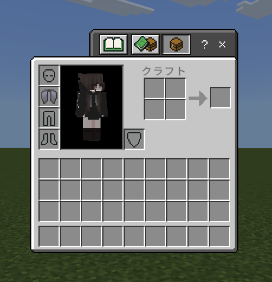

# Invisible elytra

Minecraft Bedrock Edition 用の不可視エリトラ（リソースパック）です。



## インストール

1. [Releases](https://github.com/MomokaSada/Invisible-elytra/releases) から `Invisible-elytra.mcpack` をダウンロード
2. ダブルクリックで Minecraft にインポート

詳しい使い方は [使い方](使い方.md) を参照してください。

## リリースの作り方

`v1.0.0` のようなタグを push すると、GitHub Actions が `resource_pack/` を zip して `.mcpack` を生成し、Release に添付します。

```bash
git tag v1.0.0
git push origin v1.0.0
```